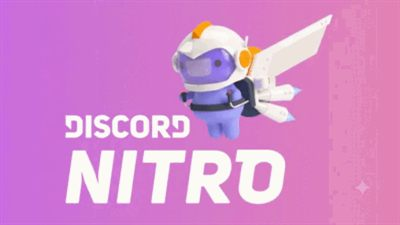

# Bot STZ · Community for FiveM

Bot de Discord para a Community for FiveM, feito em Node.js e Discord.js. O projeto reúne suporte, automações da comunidade, loja digital, pagamentos via Mercado Pago, API de anúncios e painel administrativo web.

## Vitrine real do projeto

Os cards abaixo usam as imagens presentes no repositório:

| Premium | Booster | Banner da loja |
|---|---|---|
|  |  |  |

Os três produtos iniciais são Cargo Premium (R$ 12,00), Cargo Booster (R$ 7,00) e Booster + Premium (R$ 14,00). Os preços e conteúdos exibidos podem ser alterados no catálogo; confira o painel antes de publicar a vitrine.

## Requisitos

- Node.js 20 ou superior.
- Um aplicativo de bot no Discord Developer Portal, convidado para o servidor com permissões de mensagens, canais, cargos, membros e comandos de aplicação necessários às funções ativadas.
- `cloudflared` no `PATH` se for usar `npm start` com túnel Cloudflare automático.
- Ollama instalado no mesmo computador do bot para autoatendimento e Assistente do painel. O modelo escolhido é baixado uma vez e roda localmente, sem chave de API externa.

## Instalação

```powershell
npm install
Copy-Item .env.example .env
```

Edite `.env` localmente e configure pelo menos `DISCORD_TOKEN`, `API_KEY` e uma senha forte para `DASHBOARD_PASSWORD`. Nunca envie esse arquivo pelo chat nem o adicione ao Git. `OLLAMA_MODEL` pode ser alterado se você baixar outro modelo. O `.env` já está no `.gitignore`.

No computador do bot, instale o Ollama pelo instalador oficial e baixe o modelo leve padrão:

```powershell
irm https://ollama.com/install.ps1 | iex
ollama pull qwen2.5:0.5b
```

O Ollama precisa continuar aberto no computador que executa o bot. O endpoint permitido é local (`http://127.0.0.1:11434`); o bot recusa hosts externos. Para o notebook descrito, use `qwen2.5:0.5b`. As perguntas são enviadas somente quando alguém consulta `/ia perguntar`, usa a Assistente do painel ou escreve em um ticket enquanto o autoatendimento está ativado. O bot não carrega o modelo ao iniciar e continua funcionando quando o Ollama está desligado.

O modelo pequeno pode errar ou não conhecer detalhes específicos do servidor. Ele não recebe ferramentas, não pode executar comandos ou ações administrativas e não confirma pagamentos. Revise respostas importantes e encaminhe questões específicas à equipe.

No Discord Developer Portal, habilite **Server Members Intent** e **Message Content Intent** se o bot usar os respectivos eventos e comandos. Depois confira a hierarquia: o cargo do bot precisa ficar acima dos cargos que ele entrega.

## Iniciar e parar

```powershell
npm start
```

`npm start` inicia o supervisor do projeto: tenta abrir o túnel Cloudflare Quick Tunnel e inicia o bot; reinicia os processos após saídas inesperadas. O URL `trycloudflare.com` é temporário e pode mudar. `Ctrl+C` encerra os processos iniciados pelo supervisor. Sem túnel, execute `npm run start:direct` para iniciar somente o bot e a API local.

**Publicações diárias:** wallpaper às **12:00** e um item de cada armazém (CTZ e Boosters) às **12:30**, no fuso configurado. O avanço por item é salvo por armazém; reiniciar o bot não repete o envio no mesmo dia. Arquivos acima do limite do Discord são divididos em partes sequenciais.

A API usa `API_HOST` e `API_PORT` (padrão `127.0.0.1:3001`). O túnel e o bot precisam apontar para a mesma porta. O painel local fica em `http://127.0.0.1:3001/painel`. Para acesso externo, use HTTPS e defina `DASHBOARD_PUBLIC_URL` com a URL pública completa do painel. Quick Tunnels não garantem um endereço fixo.

Se o log do `cloudflared` mostrar `Failed to refresh DNS local resolver` ou `i/o timeout`, a falha está no resolvedor DNS da máquina que hospeda o bot. No PowerShell **como Administrador dessa máquina**, verifique o adaptador ativo e configure DNS público:

```powershell
$adapter = Get-NetIPConfiguration | Where-Object { $_.IPv4DefaultGateway } | Select-Object -First 1
Set-DnsClientServerAddress -InterfaceIndex $adapter.InterfaceIndex -ServerAddresses 1.1.1.1,1.0.0.1
Clear-DnsClientCache
```

Para restaurar o DNS automático, execute `Set-DnsClientServerAddress -InterfaceIndex $adapter.InterfaceIndex -ResetServerAddresses`. A rede também precisa permitir consultas DNS de saída na porta UDP 53. O bot continua tentando reconectar o túnel; sem DNS, porém, o endereço web não fica acessível externamente.

### Instalação no Windows com atualização automática

O script `scripts/setup-windows-auto-deploy.ps1` prepara um clone Git separado em `C:\Bots\bot-stz-v1`, preserva o `.env` e os dados locais que já existirem, baixa o `cloudflared` oficial e cria uma tarefa do Windows para iniciar o supervisor no boot e verificar o branch configurado a cada minuto. Quando há novo commit, ele atualiza o código, reinstala dependências e reinicia o bot. Os logs ficam em `C:\ProgramData\BotSTZ\logs`. O computador precisa permanecer ligado e sem suspensão.

Para migrar uma instalação baixada como ZIP, pare primeiro o `npm start` antigo com `Ctrl+C`. Abra o PowerShell como Administrador na máquina de destino e rode o instalador apontando `-SourcePath` para a pasta ZIP existente. Como este repositório é público, não é necessário conectar uma conta GitHub para fazer `git fetch`. O branch padrão é `codex/painel-auditoria-repasses`; após integrar o PR, pare a tarefa `BotSTZ-AutoDeploy` e o bot, e execute novamente com `-Branch main` para acompanhar a produção.

Exemplo para a máquina remota atual (ajuste o caminho se a pasta for diferente):

```powershell
Set-ExecutionPolicy -Scope Process Bypass -Force
$ErrorActionPreference = 'Stop'
$setup = Join-Path $env:TEMP 'setup-bot-stz.ps1'
Invoke-WebRequest 'https://raw.githubusercontent.com/RaikySilvaDEV/bot-stz_v1/codex/painel-auditoria-repasses/scripts/setup-windows-auto-deploy.ps1' -OutFile $setup
& $setup -SourcePath 'C:\Users\Administrator\Desktop\bot-stz_v1-main'
```

O atualizador roda código publicado nesse repositório na máquina. Proteja a conta GitHub e limite quem pode publicar no branch acompanhado. A pasta de instalação é separada da cópia antiga; o script não apaga a pasta antiga.

## Painel web

O painel (`/painel`) mostra estado do bot, automações, canais, loja, pagamentos e pedidos. Ele também permite administrar produtos, preços, imagens, cargos de entrega, estoque, cupons e configurações disponíveis na interface. O acesso pode usar `DASHBOARD_PASSWORD`; se estiver vazia, a sessão do painel usa `API_KEY`. A rota web de autenticação usa cookie `HttpOnly` e as operações de alteração validam origem.

O botão **Abrir painel web** no painel administrativo do Discord cria um acesso de uso único com validade limitada. A interface usa ícones Lucide distribuídos localmente (`src/api/public/icons/`), sem depender de CDN, e oferece tema escuro e navegação adaptável.

A Assistente do painel é consultiva: responde sobre o estado resumido do projeto, mas não altera configurações. Ela usa o modelo Ollama local e não precisa de chave de API. Confira a disponibilidade em **Serviços**. Não inclua tokens, senhas, chaves Pix ou dados de clientes nas perguntas.

No Discord, `/ia perguntar` consulta o modelo sob demanda; `/ia status` mostra disponibilidade, modelo, fila e tempo da última geração; `/ia ajuda` resume os comandos. O atendimento de tickets usa a mesma fila limitada. Por padrão, há uma inferência por vez e até 5 pedidos aguardando, com limite de 12 solicitações por minuto. O bot confirma que recebeu a mensagem e pede para o cliente aguardar enquanto responde. Respostas longas são continuadas quando o Ollama informa que atingiu o limite de tokens e enviadas em partes que respeitam o limite do Discord.

### Ollama no Windows

No computador que executa o bot, abra o PowerShell e confira o serviço/modelo:

```powershell
ollama list
Invoke-RestMethod http://127.0.0.1:11434/api/tags
```

Se o modelo ainda não estiver instalado, execute `ollama pull qwen2.5:0.5b`. Em `.env`, mantenha `OLLAMA_HOST=http://127.0.0.1:11434` e `OLLAMA_ENABLED=true`. Não configure `OLLAMA_HOST` com IP público ou endereço de outra máquina. Para desativar apenas a IA, defina `OLLAMA_ENABLED=false`; não é necessário parar o bot. Reinicie o processo do bot depois de alterar `.env` para carregar as opções.

As opções de inferência ficam no `.env` do bot: `OLLAMA_TIMEOUT_MS`, `OLLAMA_NUM_CTX`, `OLLAMA_NUM_PREDICT`, `OLLAMA_NUM_THREAD`, `OLLAMA_KEEP_ALIVE`, `OLLAMA_MAX_CONCURRENT` e `OLLAMA_MAX_QUEUE`. Os limites de proteção são `OLLAMA_GLOBAL_RPM`, `OLLAMA_MAX_PROMPT_CHARS` e `OLLAMA_MAX_RESPONSE_CHARS`. Os valores iniciais estão em `.env.example`; concorrência é limitada a uma geração para preservar o notebook. `num_thread`, contexto e `keep_alive` são parâmetros de solicitação, não garantias rígidas de CPU ou RAM; tempo real depende do modelo, contexto e carga do Windows.

## Recursos do bot

- Verificação e boas-vindas de membros.
- Tickets, transcrições, autoatendimento com Ollama local e encaminhamento para atendimento humano.
- Parcerias e anúncios FiveM, com gerenciamento no Discord e no painel.
- API REST protegida para criar, listar, editar e remover anúncios FiveM. Exemplos: [API-POSTMAN.md](API-POSTMAN.md).
- Wallpapers, avisos programados, saudações e publicações dos armazéns CTZ e CTZ Boosters.
- Loja de cargos, carrinho, cupons, avaliações, confirmação Mercado Pago, entrega configurável e relatórios.
- Registros de auditoria e dados JSON locais.

### Comandos Slash

| Comando | Para que serve |
|---|---|
| `/ajuda` | Lista os comandos e recursos. |
| `/ping` | Mostra latência e estado da conexão. |
| `/teste` | Verifica a resposta do bot no servidor. |
| `/ia perguntar` | Faz uma pergunta ao modelo Ollama local; resposta privada e sob demanda. |
| `/ia status` | Mostra disponibilidade, modelo, fila e duração da última resposta. |
| `/ia ajuda` | Mostra as funções da IA local. |
| `/vendas` | Publica ou atualiza a vitrine de produtos. |
| `/comprar` | Abre o fluxo de carrinho e compra. |
| `/pagamentos` | Abre o painel interativo de métodos e preços. |
| `/pagamentos teste` | Cria uma cobrança Pix **real** de R$ 0,10 e, após pagamento confirmado, entrega o cargo de teste. Não use como simulação gratuita. |
| `/loja status` | Consulta catálogo, automações e estoque. |
| `/loja publicar` | Publica/atualiza a vitrine. |
| `/loja automacao` | Liga ou pausa uma automação comercial. |
| `/loja cargo` | Associa um cargo Discord ao produto. |
| `/loja instrucoes`, `/loja imagem`, `/loja link-entrega`, `/loja estoque` | Configura entrega, mídia e disponibilidade de produto. |
| `/loja cupom-criar`, `/loja cupom-remover` | Administra cupons. A aplicação de desconto depende da automação correspondente estar ativa. |
| `/loja relatorio`, `/loja feedbacks` | Consulta vendas e avaliações. |
| `/pedido aprovar` | Registra manualmente um pedido como pago e tenta entregar o produto. Use só após confirmar o pagamento por fonte confiável. |
| `/pedido entregar` | Tenta novamente a entrega de um pedido já pago. |
| `/painel` | Cria/atualiza o painel administrativo privado no Discord. |
| `/parcerias`, `/cadastrar-parceria` | Lista e administra parcerias. |
| `/anuncios-fivem` | Administra os anúncios do canal FiveM. |
| `/status` | Mostra o estado do bot e das integrações. |
| `/logs` | Consulta ações administrativas recentes. |
| `/backup` | Baixa um snapshot JSON administrativo, sem tokens nem transcrições de tickets. |
| `/configurar ver` | Mostra canais e automações configurados. |
| `/configurar canal`, `/configurar automacao`, `/configurar mencoes`, `/configurar horarios`, `/configurar fuso`, `/configurar auditoria` | Administra canais, agendamentos e logs. |

Os comandos administrativos têm checagens de autorização próprias: alguns aceitam o dono do servidor, desenvolvedores configurados ou cargos administrativos; outros são restritos ao dono. Configure `BOT_DEVELOPER_IDS` e `BOT_ADMIN_ROLE_IDS` e confira a resposta de acesso de cada comando. A lista de produtos nas opções do Discord é formada pelos produtos ativos quando os comandos Slash são registrados.

As automações comerciais podem ser ativadas separadamente. Confirme cada status no painel; existir código para uma automação não significa que ela esteja ativa nem que os canais/cargos estejam configurados.

## Mercado Pago

A integração de compra usa Mercado Pago Pix e confirma os pedidos consultando a API a partir de webhooks assinados. O QR Code/copia e cola é gerado com o valor do pedido. Para ativar, configure no `.env`:

```dotenv
MERCADO_PAGO_ACCESS_TOKEN=
MERCADO_PAGO_WEBHOOK_SECRET=
MERCADO_PAGO_WEBHOOK_URL=https://SEU_HOST/api/webhooks/mercado-pago
```

O endereço de webhook precisa ser público, HTTPS e terminado em `/api/webhooks/mercado-pago`. Ative a automação Mercado Pago no painel e teste com as credenciais e cenários próprios do Mercado Pago antes de vender. O painel não deve ser usado como substituto da confirmação assinada do provedor; comprovantes enviados por compradores não confirmam pagamentos.

### Repasse ao sócio

Payouts para uma chave Pix é um fluxo financeiro distinto do checkout. O valor deverá ser calculado por uma regra explícita sobre pedidos pagos; cada repasse requer histórico persistente, chave idempotente, autorização administrativa e consulta do estado até a confirmação final. O Payouts do Mercado Pago pode exigir elegibilidade da conta, saldo disponível e, em produção, cadastro da chave pública de assinatura específica do produto. Nunca use o token de checkout ou a Public Key do painel como chave de assinatura de Payouts. A chave Pix do destinatário é dado sensível: configure-a somente no painel protegido, nunca em issue, commit ou chat.

> A existência da integração de checkout não habilita nem prova que Payouts esteja liberado na sua conta. Faça testes de Payouts separados e mantenha transferências reais desativadas até validar conta, assinatura, saldo, webhook e reconciliação.

O repasse ao sócio usa a porcentagem configurada sobre cada pedido confirmado como pago, antes das tarifas do provedor, com arredondamento para centavos por pedido. A automação vem desligada; a equipe precisa criar um repasse no painel e confirmar o envio explicitamente. O modo de teste é o padrão e limita o valor por transferência; credencial e elegibilidade de Payouts são independentes das credenciais de Checkout. A URL pública de notificação deve permanecer estável e apontar para `/api/webhooks/mercado-pago-payouts`.

## Configuração

| Variável | Uso |
|---|---|
| `DISCORD_TOKEN` | Token privado do bot. |
| `OLLAMA_ENABLED` | Habilita/desabilita chamadas à IA sem afetar o bot (padrão `true`). |
| `OLLAMA_HOST` | Endereço local permitido (padrão `http://127.0.0.1:11434`). `OLLAMA_URL` antigo continua aceito como fallback. |
| `OLLAMA_MODEL` | Modelo Ollama já baixado (padrão `qwen2.5:0.5b`). |
| `OLLAMA_TIMEOUT_MS`, `OLLAMA_NUM_CTX`, `OLLAMA_NUM_PREDICT`, `OLLAMA_NUM_THREAD`, `OLLAMA_KEEP_ALIVE` | Limite de tempo e parâmetros por geração local. |
| `OLLAMA_MAX_CONCURRENT`, `OLLAMA_MAX_QUEUE` | Concorrência (limitada a uma geração) e limite de fila. |
| `OLLAMA_GLOBAL_RPM` | Proteção contra excesso de consultas; solicitações permitidas aguardam na fila da IA. |
| `OLLAMA_MAX_PROMPT_CHARS`, `OLLAMA_MAX_RESPONSE_CHARS` | Limites do texto enviado e retornado. |
| `API_KEY` | Bearer da API de anúncios e fallback de senha do painel. |
| `DASHBOARD_PASSWORD` | Senha dedicada ao painel (recomendado). |
| `API_HOST`, `API_PORT` | Endereço local e porta HTTP. |
| `DASHBOARD_PUBLIC_URL` | URL pública HTTPS de `/painel`, se houver. |
| `BOT_TIME_ZONE` | Fuso IANA, por padrão `America/Sao_Paulo`. |
| `BOT_DEVELOPER_IDS` | IDs de desenvolvedor adicionais separados por vírgulas. |
| `BOT_ADMIN_ROLE_IDS` | IDs de cargos que podem usar recursos administrativos. |
| `MERCADO_PAGO_ACCESS_TOKEN` | Access Token de servidor do Mercado Pago; nunca exponha no navegador. |
| `MERCADO_PAGO_WEBHOOK_SECRET` | Segredo usado para verificar a assinatura de webhooks. |
| `MERCADO_PAGO_WEBHOOK_URL` | URL pública HTTPS configurada para notificações de pagamento. |

Veja [`.env.example`](.env.example) para os nomes e valores padrão, sem credenciais reais.

## Dados e recuperação

O estado persistente fica em `data/`; arquivos JSON são atualizados por gravação temporária e renomeação atômica. Arquivos de estado e logs locais são ignorados pelo Git. Faça cópias de segurança da pasta `data/`, assets próprios, `ModArmazem/`, `Wallpapers/` e do `.env` em armazenamento seguro. Não armazene backups do `.env` dentro do repositório.

O armazenamento JSON é adequado para uma única instância do bot. Não execute duas instâncias apontando para a mesma pasta de dados; não há bloqueio distribuído para múltiplos processos.

## Verificações de desenvolvimento

```powershell
npm run check
npm test
```

Os testes automatizados devem usar mocks e não publicar mensagens no Discord, cobrar clientes ou executar Payouts reais. Para validar a integração financeira, faça um roteiro manual com credenciais de teste e fixtures oficiais, sem usar uma chave ou conta de destinatário real.

## Estrutura

```text
src/
  api/          API HTTP, autenticação, webhook MP e painel web
  commands/     Definições e registro dos comandos Slash
  config/       IDs, produtos e validação do ambiente
  data/         Persistência JSON atômica
  events/       Eventos Discord
  features/     Comunidade, tickets, loja, pagamentos e automações
  process/      Supervisor do bot e do túnel
  repositories/ Acesso aos dados persistidos
  services/     Integrações e regras reutilizáveis
assets/store/   Imagens locais dos produtos
```

## Licenças e atribuições

Os ícones locais são do [Lucide](https://lucide.dev/), distribuídos sob licença ISC. As imagens comerciais e os arquivos de produto pertencem aos respectivos autores/proprietários.
